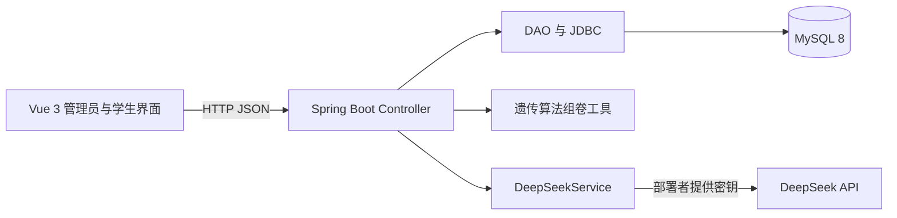

# 在线考试系统设计

## 架构

前端通过 src/api/index.ts 统一访问接口，使用 reactive store 管理当前会话，App.vue 控制功能页面切换。后端按 config、controller、dao、model、service 与 util 分组，数据库访问基于 JDBC 与 Druid 连接池。

## 数据库

| 表 | 作用 |
| --- | --- |
| user | 管理员、学生及首次登录标记 |
| question | 题干、选项、答案、分类、类型与难度 |
| exam | 考试名称、时长、发布状态与平均难度 |
| exam_question | 考试与题目关联、顺序、分值及删除标记 |
| exam_record | 学生答卷、得分与提交时间 |
| wrong_question_analysis | 学生错题的 AI 解析缓存 |
| mastered_question | 学生已掌握题目标记 |
| student_wiki | 学生个人知识点掌握度与学习说明 |
| knowledge_wiki | 管理员题库知识总结与质量分析 |

表结构见 [init.sql](../exam_web/backend/src/main/resources/init.sql)，不包含真实业务记录。

## 接口入口

- `/api/user`：登录、学生账号维护、修改密码。
- `/api/question`：题库管理与分类查询。
- `/api/admin/exam`：手动/自动组卷、考试状态、答卷、区分度与导出。
- `/api/admin/deepseek`：根据考点生成题目。
- `/api/admin/wiki`：题库知识 Wiki。
- `/api/student`：学生考试、练习、错题、知识图谱及周报。

完整请求字段以 Controller 与前端 API 封装为准。本项目尚未提供独立 OpenAPI 规范。

## AI 与组卷的边界

遗传算法从已有题库选题，评价目标平均难度和分类覆盖，不调用大模型。AI 出题由 DeepSeek 生成候选题目；管理员确认后再导入题库。错题与知识分析按接口逻辑将相关题目、作答信息发送给配置的 AI 服务，部分结果写入缓存表。

模块与课程设计需求对照见 [课程设计参考](course-design.md)。
